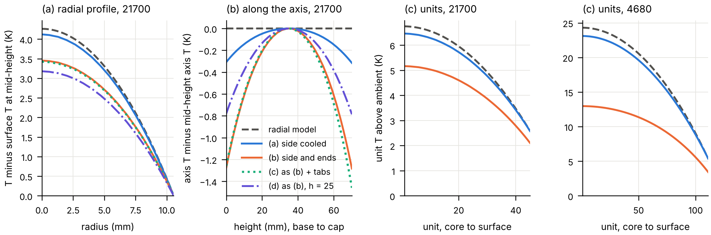
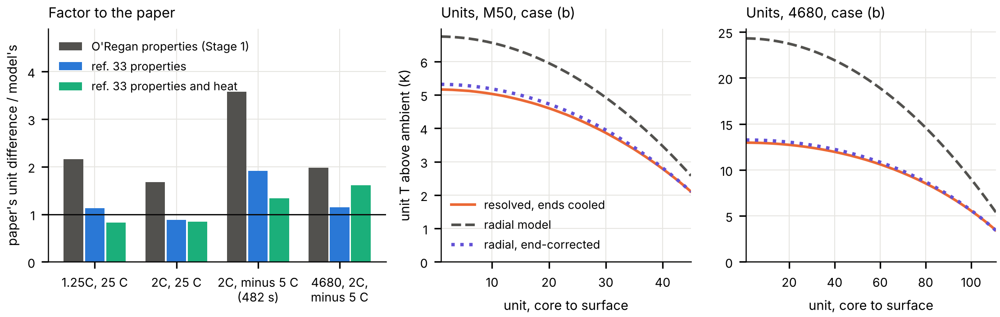

# The axial blind spot of a radial cell model: the temperature field a multi-unit model assumes, tested on the LG M50 and a 4680

Siddharth Satte, Independent researcher, Pune, India, 21 October 2026 (v1.1.0). doi.org/10.5281/zenodo.23320970. Predictions commit b92f9a8, public at 11:12 UTC on 12 October before any three-dimensional field was computed. [github.com/siddharth161204-wq/m50-radial-vs-resolved-field](https://github.com/siddharth161204-wq/m50-radial-vs-resolved-field){.nobr}.

1. In the multi-unit model of Yang, Cui and Tartakovsky (J. Electrochem. Soc. 173 (2026) 050520), each unit takes its temperature from a radial model, which in three dimensions means insulated ends. Under that condition the resolved cell agrees: at 2C and minus 5 C every unit lies within 0.29 K of the radial value in the LG M50 and within 1.2 K in a 4680. With the ends cooled at the paper's own h = 400 W/(m^2^ K), the axial difference along the core that a radial model cannot see is 37 % of the radial core-to-surface difference in the M50 (1.28 of 3.45 K) and 32 % in the 4680 (3.44 of 10.61 K), at every rate and ambient run.
2. The radial model then puts every unit too warm: by 0.48 to 1.59 K in the M50 (mean 1.19 K, 31 of 45 units by more than 1 K) and by 1.9 to 11.3 K in the 4680 (mean 8.0 K). It overstates the unit-to-unit spread by 36 % (4.17 against 3.06 K) and by 98 % (18.9 against 9.5 K).

Figure 1. 2C and minus 5 C, end of discharge (1706.7 s). Left: mid-height temperature above the mid-height surface temperature, M50, the radial model against the resolved cell under the four boundary conditions. Second: axis temperature relative to mid-height, base to cap, same cases. Right, two panels: unit temperatures above ambient in the M50 and the 4680, the radial model (dashed) against the resolved annulus averages with the ends insulated (a) and cooled (b).

## Method

1. Heat: PyBaMM's Doyle-Fuller-Newman model, parameter set Chen2020, discharging at 1.25C, 2C and 3C from 100 % SOC to 2.5 V at minus 5 C and 25 C, with the lumped thermal model at h = 400 on the side. The total heat is applied uniformly per volume in every thermal model, and the 4680 gets the same W/m^3^.
2. Properties: O'Regan et al. (Electrochim. Acta 425 (2022) 140700) through PyBaMM at 25 C: 2938.7 kg/m^3^, 842.4 J/(kg K), and 1.225 W/(m K) across and 25.09 W/(m K) along the layers. The can is 0.25 mm of steel at 15 W/(m K) and 841.7 J/(m^2^ K).
3. Radial model: the paper's Eq. 2 and 4 on a solid cylinder, with 45 units (21.1 by 70.1 mm) and 111 units (46 by 80 mm) as equal-thickness annuli and the can's heat capacity at the surface. A unit's temperature is its annulus average.
4. Resolved cell: the scikit-fem cell of the two-cell study (doi.org/10.5281/zenodo.23253738), with an anisotropic roll and the can as a shell on every surface. Unit averages are taken over the annulus and the full height.
5. Boundary conditions: (a) side at h = 400, ends insulated; (b) side and ends at h = 400; (c) as (b) plus two nickel strips (6.2 mW/K each) to busbars at ambient; (d) as (b) at h = 25. The 4680 runs (a) and (b).
6. Checks:
   - With the can on the side only, the resolved cell matches the radial model within 0.15 %. This holds after the circumferential conductivity was set to the radial value, because the along-layer value failed this test by 1.7 % on the coarse mesh near the axis.
   - Energy closes to 2e-12; halving every mesh spacing changes the core-to-surface difference by 0.09 %; an independent axisymmetric solver agrees within 0.15 %.

## Limits

1. The source is uniform where the paper's is unit-resolved and temperature-dependent. The heat is PyBaMM's default total, without the heat of mixing, which would add 36 to 54 % for this set. The axial-to-radial fractions are the same at every rate and ambient; the spread overstatement is 34 to 36 % in the M50 and 78 to 101 % in the 4680; the kelvin values scale with the heat.
2. The paper's properties come from its ref. 33, a pseudo-two-dimensional model with a one-dimensional thermal model of the same M50, fitted to 1C discharge data; its values were not available here. The paper's unit differences are larger than this radial model's: 2.2 and 1.7 times at 1.25C and 2C at 25 C, where both discharges end near full, and 3.5 to 3.6 times at 2C and minus 5 C, where the paper's discharge ends at 1.34 to 1.50 A h against 4.74 A h here. Its heat is larger or its conductivity lower. The roll touches the can's end caps directly, so the end effects are upper bounds.
3. No electrochemical feedback is computed here. The offsets are temperature offsets, which the paper's surrogate would turn into current and energy differences, not energy errors.

## Prediction scorecard

| | Prediction | Result | Computed |
|--|-------------------------------------------------|------|---------------------------------------------|
| P1 | Side cooling only: mid-height core-to-surface 3 to 10 K at 2C, minus 5 C | Held | 4.12 K (central 6 K) |
| P2 | End cooling changes it by under 30 %, axial over a third of radial | Held | -16 % and 0.37 (central 15 % and 0.5) |
| P3 | End cooling: radial units 1 to 3 K too warm, about equally, spread within 20 % | Failed | Mean 1.19 K, all positive; the spread falls 27 % |
| P4 | The 4680's axial-to-radial ratio is smaller than the 21700's | Held | 0.32 against 0.37 (central 0.3 against 0.5) |
| P5 | At h = 25 both differences are below 1 K at 2C | Failed | Radial 3.18 and 2.62 K, axial 0.79 and 0.65 K |

## What it means for the paper's numbers

Under the condition the paper's radial model implies, insulated ends, the resolved field supports it. If a cell's ends exchange heat as its side does, the unit temperatures that drive the paper's current redistribution are too warm, and their spread too wide by about a third in the M50 and by up to a factor of two in the 4680, so its 3.45 % and 11.32 % energy overestimates and its difference of more than 30 C across the 4680 would be expected to shrink, by an amount this study does not compute.

## Stage 2 (v1.1.0): the gap to the paper, and an end correction

Predictions commit 0cb04c3, public at 06:37 UTC on 21 October 2026 before any Stage 2 computation; nine of ten held.

1. The paper's ref. 33 fits its thermal values to one 1C discharge of the same M50: 0.62 W/(m K) across the layers and 3.44 MJ/(m^3^ K), against O'Regan's 1.23 and 2.48. They raise this model's unit differences in the M50 by a factor of 1.9 at every condition, taking the factor to the paper from 1.7 to 2.2 to 0.88 to 1.13 at 25 C, and from 3.5 to 3.6 to 1.87 to 1.91 at 2C and minus 5 C.
2. Ref. 33's electrochemical set in PyBaMM ends the 2C, minus 5 C discharge at 1.51 A h, where the paper's ends, with 1.38 to 1.40 times Chen2020's heat. With its properties and heat the remaining factor is 0.82 to 0.85 at 25 C and 1.25 to 1.33 at minus 5 C.
3. A derived, unfitted sink β (T minus T~amb~), with β = 2 h~e~/L and 1/h~e~ = 1/h + L/(6 k~z~), takes the case (b) unit offset from 1.19 to 0.10 K (M50) and from 7.96 to 0.21 K (4680), and the spread overstatement from 36 and 98 % to 5 and 3 %. It matches the resolved end share within 0.5 points and the axial difference at the core within 2 %.

Figure 2. Left: the paper's unit difference over this model's, with each set of inputs (2C, minus 5 C at the paper's end of discharge, 482 s; the 4680 with the 21700's heat history). Right: case (b) at 2C and minus 5 C, end of discharge: resolved unit temperatures, the radial model, and the radial model with the end correction.

